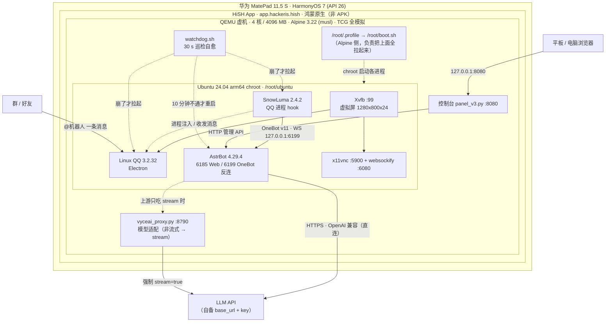
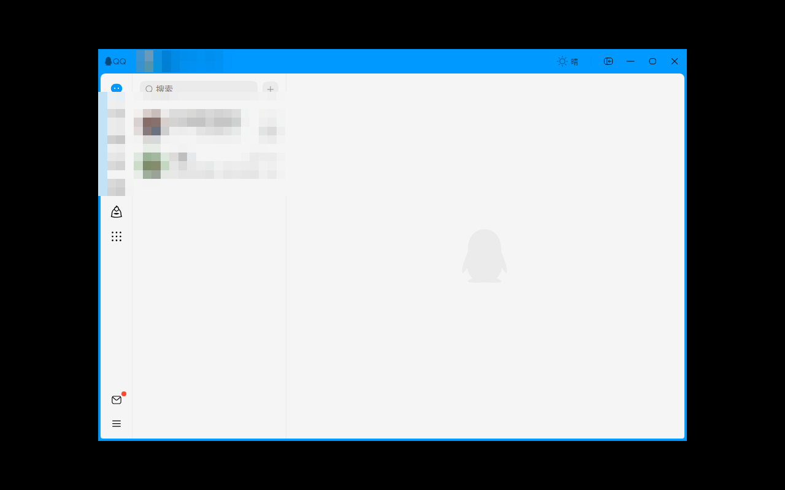
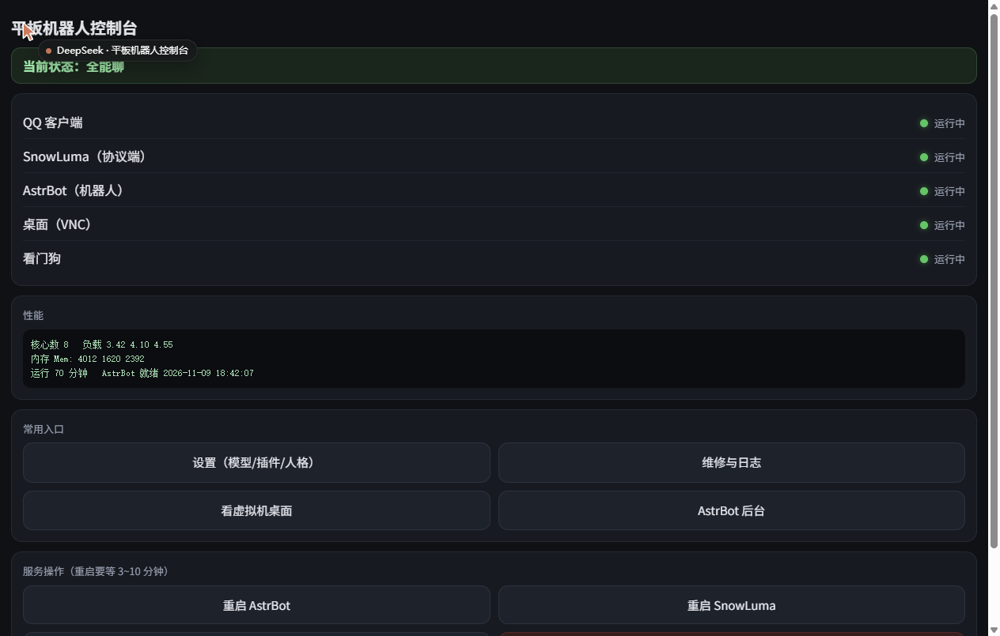
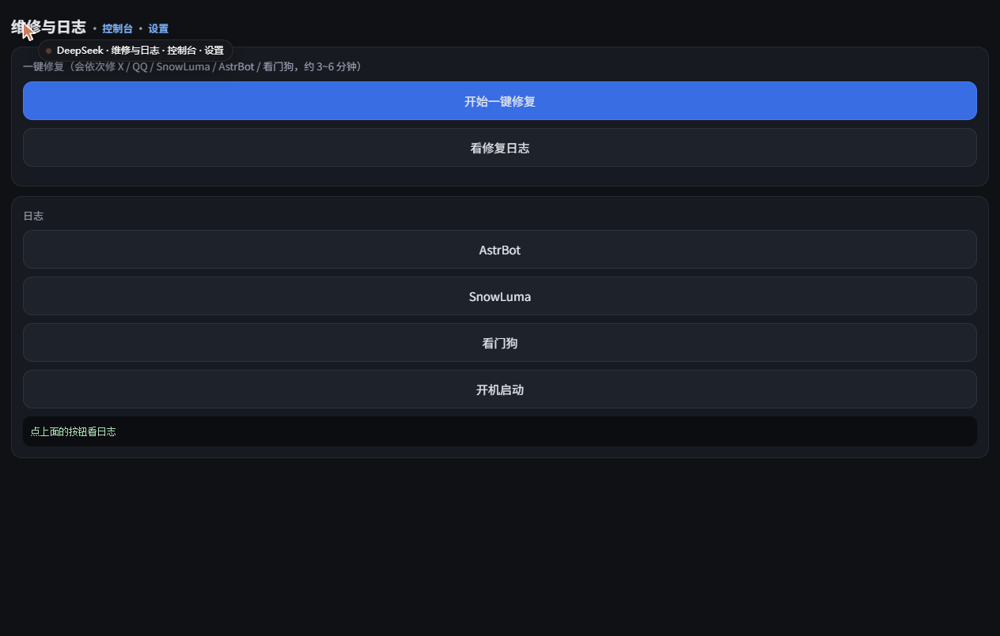

# HiSH QQBot

在 HarmonyOS 7 平板（华为 MatePad 11.5 S）上，靠 HiSH 里的 QEMU 虚机跑起「Linux QQ + SnowLuma + AstrBot」的完整部署工程：不用电脑、不用手机挂机、不用 root 平板，开机自动拉起，浏览器就能管。

> 目前状态：Linux + 图形 + QQ 登录 + SnowLuma 注入 + AstrBot 连模型 + 重启自启 **已实测通过**；
> 「群里 @ 一下自动回复」的端到端链路 **待验证**（等一条真实群消息）。详见 [docs/testing.md](docs/testing.md)。

---

## 目录

- [架构](#架构)
- [能力清单](#能力清单)
- [截图](#截图)
- [快速开始](#快速开始)
- [四个入口端口](#四个入口端口)
- [性能与稳定性](#性能与稳定性)
- [模型对接的两种姿势](#模型对接的两种姿势)
- [已知限制](#已知限制)
- [仓库结构](#仓库结构)
- [文档](#文档)
- [许可证](#许可证)

---

## 架构

一句话：**鸿蒙 → HiSH（一个 App）→ 里面一台真正的 Linux 虚拟机 → 里面跑 QQ + 网关 + 机器人**。



为什么绕这一大圈，而不是装个安卓 APK？因为 **HarmonyOS NEXT 不是 Android**：装 APK 只能经「卓易通」容器，而卓易通是 syscall 白名单 + **封掉 ptrace**，PRoot 那套（`astrbot-for-android` 一类一键 APK 的核心）全部失效，报 `getcwd ENOSYS` / `SIGSYS`。要拿到完整内核能力，只能换层——用真虚拟机。因果链和取舍见 [docs/architecture.md](docs/architecture.md#3-为什么鸿蒙上必须用-qemu-虚机)。

---

## 能力清单

| 能力 | 状态 | 说明 |
|---|---|---|
| 平板独立运行，不依赖电脑/手机 | ✅ | 虚机内自包含，断电脑也能跑 |
| 开机自动拉起全套 | ✅ | `/root/.profile` 钩子 → `boot.sh`，重启虚机实测有效（HiSH 的 Alpine 默认关掉 OpenRC，不能用 `rc-update`） |
| Linux QQ 自动登录 | ✅ | 已扫码过的会话持久化，重启免扫 |
| QQ 进程 hook + OneBot v11 | ✅ | SnowLuma 2.4.2，`hookAutoLoad: true` 开机自动注入 |
| AstrBot 接入大模型 | ✅ | OpenAI 兼容源，走 `ws_reverse_port 6199` 反向 WS |
| 手机/浏览器管理控制台 | ✅ | 8080（`panel_v3.py`）：体检卡 + 四状态灯 + 性能快照 + 模型/插件开关 + 人格/唤醒词 + 一键重启 + 维修页（`/quick`：一键修复 + 日志尾）（AstrBot 后台密码登录报错，待修） |
| 崩溃自愈 | ✅ | `watchdog.sh` 每 30 s 巡检 X / QQ / SnowLuma / AstrBot，崩了自动拉起（QQ 重启后会自动重挂 SnowLuma） |
| 一键修复 + 体检 | ✅ | `quick.sh` 幂等跑 8 个阶段自检，从控制台「一键修复」或 PC `pc_bootstrap.py` 都能触发 |
| 远程桌面看 QQ 界面 | ✅ | noVNC 6080，扫二维码/掉登录时救急 |
| 群里 @ 自动回复（端到端） | ⏳ 待验证 | 各段单独确认可用，缺一条真实群消息的实测记录 |
| 无 GPU 下省 CPU | ✅（可选） | `hide_qq.sh` 把 QQ 窗口 unmap，实测窗口可见时吃 40%+ CPU |
| 平板上直接开 SnowLuma 面板 | ⏳ 可选 | 需要再加一条 5099 端口映射 |

---

## 截图

| 虚机桌面：Linux QQ 已登录 | 8080 控制台首页（v3） | 8080 设置页（v3） | 8080 维修页（v3） |
|---|---|---|---|
|  |  |  |  |

- **01** `01-vm-desktop.png`（1280×800，**平板真机截图**）：Xvfb `:99` 的虚机桌面，Linux QQ 已登录、会话列表可见（昵称/群名/好友名已打码）——证明「扫码登录 + SnowLuma 注入」这两段通了。
- **02** `02-console.png`（v3 预览渲染）：控制台首页——顶部**体检卡**一句话给结论（全能聊 / 部分可用 / 未就绪）、5 行状态灯（QQ / SnowLuma / AstrBot / 桌面 VNC / 看门狗）、性能卡（核数 / 负载 / 内存 / 运行时长 / AstrBot 就绪时刻）、常用入口与服务操作。
- **03** `03-settings.png`（v3 预览渲染）：设置页——模型开关（`ben/deepseek-v4.1-flash` 开、`vyceai/deepseek-v4.1` 关）、插件开关、人格编辑、唤醒前缀。**改完即时生效**（模型切换需重启 AstrBot），全程不碰命令行。
- **04** `04-repair.png`（v3 预览渲染）：维修页——一键修复（后台跑 `quick.sh`）+ 四类日志（AstrBot / SnowLuma / 看门狗 / 开机启动），出问题先点这个。

> 诚实说明：01 是真机截图；02/03/04 是用 `tools/panel_preview.py`（固定示例数据）在 PC 上渲染的 v3 界面，**界面就是实际代码**，只是背后没有真虚机。平板回来后建议用真机同路径覆盖。

更多截图规范与脱敏清单见 [docs/screenshots/README.md](docs/screenshots/README.md)。

---

## 快速开始

完整步骤见 [docs/flow.md](docs/flow.md)（7 个阶段）。最短路径：

1. **准备平板**：设置里连点「软件版本」5 次开开发者模式；装 HiSH，进终端。
2. **调虚机**：HiSH 终端右下角齿轮 → 模拟器管理 → 修改 → **4 核 / 4096 MB**；加端口映射 **客户机 6185 ↔ 主机 6185**（默认只有 512 MB / 1 核，装不动东西）。
3. **装 Linux**：虚机里 `apk add tar`，解 Ubuntu 24.04 arm64 base 到 `/root/ubuntu`，挂 `proc/dev/sys` 后 `chroot` 进去，apt 源换 `ubuntu-ports`（arm64 必须 ports）。
   ```sh
   sh scripts/install.sh 2      # 骨架脚本，阶段 2
   ```
4. **装图形 + QQ**：chroot 里装 `xvfb` 与 GTK/NSS 等运行库，起 `Xvfb :99`，装 Linux QQ 到 `/opt/QQ/qq`，首次扫码登录。
5. **装 SnowLuma**：解到 `/root/sl`，浏览器开 `127.0.0.1:5099` 授权 → 设密码 → 选中 QQ 进程「加载」注入 → OneBot 指向 `127.0.0.1:6199` → 勾 `hookAutoLoad`。
6. **装 AstrBot**：clone 到 `/root/src/AstrBot-master`，venv 隔离装依赖，`patch_cfg.py` 把 platform 改成 `aiocqhttp` + `ws_reverse_port 6199`，配一个可访问的 OpenAI 兼容模型源。
7. **装自启**：`sh scripts/install.sh 7` 把脚本铺到 `/root/` 并往 `/root/.profile` 追加启动钩子；重启虚机验证。

预期验证点（每步都该有输出，别靠感觉）：

```sh
pgrep -f 'Xvfb :99'; pgrep -f '/opt/QQ/qq'; pgrep -f index.mjs; pgrep -f 'main[.]py'   # 应有 4 个 PID
netstat -ltn | grep -E '5099|5900|6080|6185|6199|8080'
tail -50 /root/boot.log
```

---

## 四个入口端口

| 端口 | 是什么 | 怎么访问 | 备注 |
|---|---|---|---|
| **8080** | 本工程的控制台（`panel_v3.py`） | 平板或电脑浏览器 `http://127.0.0.1:8080` | 需要 HiSH 端口映射 8080；**无鉴权**，别放公网 |
| **6185** | AstrBot Web 后台 | `http://127.0.0.1:6185`（平板需映射 6185） | 首启动 3–4 分钟才可用；面板密码登录报错（待修，不影响聊天） |
| **5099** | SnowLuma 面板（授权 / 注入 / WS 配置） | `http://127.0.0.1:5099` | 平板本地直开需额外映射 5099（可选）；注入与改配置必须在真机上做 |
| **6080** | noVNC 桌面（websockify → 127.0.0.1:5900） | `http://127.0.0.1:6080/vnc.html` | 用来扫码/看 QQ 界面；x11vnc 是 `-nopw` 无密码，仅限本机 |

内部还有两个**不要对外**的端口：`6199`（AstrBot 的 OneBot 反向 WS 服务端，SnowLuma 连它）、`5900`（x11vnc 原始 RFB）。

---

## 性能与稳定性

先接受一个物理事实：**HiSH 里的 QEMU 只跑 TCG（纯软件 CPU 模拟），这台机器没有 KVM。** 单核性能大约只有同代 PC 的 1/10，所以「优化」的天花板是「能用」，不是「像电脑一样快」。这一节写清楚三件事：为什么慢、崩溃了谁管、日常怎么用才不把自己拖死。

### 为什么慢：8 个叠加原因（不是玄学）

| # | 原因 | 实测表现 | 能做什么 |
|---|---|---|---|
| 1 | **无 KVM**，指令逐条翻译 | 单线程性能天花板，冷启动按分钟计 | 无解，只能减少启动次数 |
| 2 | **8 vCPU 全饱和** | `load average 8.34`，AstrBot + QQ + SnowLuma 抢同一批核 → 6185 后台 502/超时 | 降到 4 核（见下），稳定性优先于峰值速度 |
| 3 | **Linux QQ 是 Electron** | 一个 QQ = 8~10 个进程、约 1.2 GB RSS，是最重的一块 | `hide_qq.sh` unmap 窗口；`--js-flags=--max-old-space-size=384` |
| 4 | **14 个插件** | 冷启动逐个 `import`，jieba 词典、向量检索、图片渲染都要热身 | `optimize.sh` 预编译 `.pyc`；关掉不用的插件 |
| 5 | **chroot 套 Alpine** | 多一层文件系统与库（但比 PRoot 快，是有意的取舍） | 保持现状，别为了「纯净」换成 PRoot |
| 6 | **浏览器一次开 4 个页面** | 实测 4 个全开 → 四个端口全部白屏；只开 1 个 → 四端口全 200 | 一次只开一个网页（见下） |
| 7 | **4 GB 无 swap** | 峰值一挤就 OOM / 抖动 | 提到 6 GB（HiSH 编辑页可选 6144） |
| 8 | **重启即失联** | X 锁残留、`z2.sh` 通道退出，只能在 hdc 里重敲命令 | `quick.sh` 一条命令重建；watchdog 兜住进程 |

> 第 2 条有个反直觉的结论：**核数不是越多越好。** 8 vCPU 下 TCG 的 SMP 不稳，Linux QQ（Electron）会偶发原生崩溃，SnowLuma 报 `process enumeration timed out`；4 核是早前「连跑几小时不崩」的配置。**稳定性优先于峰值速度。**

### 看门狗自愈（`scripts/watchdog.sh`）

每 **30 秒**（`INTERVAL` 可调）巡检四项，崩了就拉起来，人工不必守着：

| 巡检对象 | 判据 | 触发后的动作 | 日志 |
|---|---|---|---|
| Xvfb | chroot 内 `DISPLAY=:99 xdpyinfo` 能否跑通 | 强杀残留 → 删 `.X99-lock` / `X11-unix/X99` → 重起 Xvfb → 等 8 s | `/root/watchdog.log`、`/root/xvfb.log` |
| Linux QQ | `pgrep -f "qq --no-sandbox"` | 带四个禁用参数重起 → 等 30 s → **再重挂 SnowLuma**（重启后 hook 必失效） | `/root/qq.log` |
| SnowLuma | `pgrep -f "index.mjs"`，且 QQ 在 | `restart_snowluma.sh`（避免顺序错，QQ 不在时不动） | `/root/sl.log` |
| AstrBot | 进程在，但 6185 **连续 20 次（约 10 分钟）** 不通 | `restart_astrbot.sh` | `/root/ab.log` |

给 AstrBot 留 10 分钟宽容期是刻意的：它冷启动本来就要好几分钟，**杀早了等于永远起不来**。当前巡检快照在 `/root/watchdog.state`（`x=` / `qq=` / `sl=` / `ab=` 四个字段，出问题先看它）。

### 冷启动耗时（TCG 口径）

| 阶段 | 早期 4 核记录 | 8 vCPU 实测 | 验收目标 |
|---|---|---|---|
| `boot.sh` 打印 `BOOT_DONE` | 约 27 s | 约 27 s | —（只代表进程起来） |
| AstrBot 冷启动 → 6185 可访问 | 3–4 分钟 | **6~10 分钟** | **≤ 5 分钟**（未达标，见下） |
| 冷启动 → 群里能收到回复 | — | 8 分钟以上 | **≤ 8 分钟** |
| 单条回复延迟 | — | 5~60 s | **P50 ≤ 30 s**、**P95 ≤ 90 s** |

两个口径不一致是真实存在的：早期 3–4 分钟是 4 核 + 插件未铺满时的记录，今天 8 vCPU + 14 插件下实测 6~10 分钟。**以你当前配置下 `/root/boot.log` 与 `boot.sh` 的时间戳为准**，不要拿文档里的数字当 SLA。上表的「验收目标」目前**未全部达成**（见 [CHANGELOG](CHANGELOG.md) 已知问题）。

### 操作纪律：一次只开一个网页

这是**最影响体感**的一条，且不花钱：

- 8080（控制台）、6185（AstrBot 后台）、6080（noVNC）、5099（SnowLuma 面板）**同时只开一个**。
- 实测依据：一次开 4 个页面 → 全部白屏（VM 被拖死）；只开 1 个 → 四个端口全部 200。
- 用完就关标签页，别让后台页面持续轮询；需要来回看时，宁可来回切换，也不要并排开。

其余几条同样便宜且有效：开机 210 s 后自动 `hide_qq.sh`（窗口可见时软件渲染吃 40%+ CPU）、改配置集中在一次重启里做完（每次重启 = 一次 6~10 分钟等待）、用 `optimize.sh` 预编译 `pyc`。

---

## 模型对接的两种姿势

AstrBot 侧都是「OpenAI 兼容 provider」，区别只在于 **`api_base` 指向谁**。选错姿势的典型症状是「API key 明明是对的，却一直 `invalid_request`」。

### 姿势一：直连 OpenAI 兼容网关（推荐）

`api_base` = 上游网关自己的地址（通常以 `/v1` 结尾），key 用该站给的：

```text
AstrBot provider
  api_base = https://<你的网关>/v1     # 直连上游
  api_key  = <该站的 key>
  model    = deepseek-v4.1            # 实测用过的模型名
```

前提到位就选这个：少一跳、少一个进程、PC 不用开机。先确认平板能出网并拿到正常响应：

```sh
curl -sS -m 60 -X POST "https://<你的网关>/v1/chat/completions" \
  -H "Authorization: Bearer <key>" -H 'Content-Type: application/json' \
  -d '{"model":"deepseek-v4.1","messages":[{"role":"user","content":"ping"}]}' | head -c 300
```

### 姿势二：经 `scripts/vyceai_proxy.py` 走「只接受流式」的网关

有些中转站（实测 vyceai.com）对 `deepseek-v4.1` **只接受 `"stream": true`**，非流式请求一律返回 `{"error":{"code":"invalid_request"}}`；而 AstrBot 默认走非流式调用。这时在中间加一层翻译：

```text
AstrBot ──非流式 POST /v1/chat/completions──▶ 127.0.0.1:8790 (vyceai_proxy.py)
        ──强制 stream=true──▶ https://vyceai.com/v1 ──SSE 增量──▶
        ──拼回标准 chat.completion JSON──▶ AstrBot
```

`api_base` 此时指向**本机代理**，不是上游：

```text
AstrBot provider
  api_base = http://127.0.0.1:8790/v1   # 指向代理
  api_key  = <上游的 key>                # 代理原样透传 Authorization
  model    = deepseek-v4.1
```

```sh
nohup python3 /root/vyceai_proxy.py >/root/vyceai_proxy.log 2>&1 &
curl -s -o /dev/null -w '%{http_code}\n' http://127.0.0.1:8790/v1/models   # 期望 200
```

代理默认 `UPSTREAM=https://vyceai.com/v1`（可用环境变量改）、`PORT=8790`、`TIMEOUT=300`（要等整段生成完，别调小）。它只 bind `127.0.0.1`——**不要改 0.0.0.0，也不要做端口映射**，否则等于把带 key 的上游通道开给同网段所有人。

### 两种姿势怎么选

| 判据 | 直连（姿势一） | 代理（姿势二） |
|---|---|---|
| 上游接受非流式 | ✅ 用这个 | 不必 |
| 上游只吃 `stream: true` | ❌ 直接接必报 `invalid_request` | ✅ |
| 上游拒绝平板出口 IP | ❌ | ✅（PC 转发时，见下） |
| 额外进程 / 故障面 | 无 | 多一个 8790，挂了要单独重启 |
| 依赖 PC | 否 | 否（代理跑在平板虚机里） |

**变体（兜底，非上面两种之一）**：`scripts/use_pc_gw.py` 把模型源切到 **PC 上的 OpenAI 兼容网关**（PC 侧 `fwd8789.py` 转发 8789，只为解决「vyceai 拒绝平板出口 IP」）。实测该网关的 `ben/deepseek-v4.1-flash` 在 VM 内返回「正常」，但这条路**依赖 PC 开机**，与「平板当服务器」的初衷冲突，只当临时兜底。

---

## 已知限制

- **慢是物理上限，不是配置问题。** QEMU 在鸿蒙上只能跑 TCG（纯 CPU 模拟），比真机慢 5–10 倍。AstrBot 冷启动 3–4 分钟（8 vCPU + 14 插件下实测 6~10 分钟），`pip install` 可能 20–40 分钟。看到「没反应」先等满时间再看日志。
- **8 vCPU 下 Electron QQ 容易崩。** TCG 的 SMP 在 8 核下不稳，Linux QQ 会偶发**原生崩溃**（Electron 进程级崩溃栈，报错里带 `Bugly`），SnowLuma 偶发 `process enumeration timed out`。**建议调回 4 核（或 6 核）**：4 核是「连跑几小时不崩」的配置，8 核只是跑分好看。崩了由看门狗 30 s 巡检拉起，但一次恢复要几分钟，期间群里没人应答。
- **`vyceai` 这类中转站可能只支持 `stream: true`，且当前整站不可用。** 直连会稳定报 `invalid_request`（不是 key 错也不是网络问题）；即便走 `scripts/vyceai_proxy.py`，只要上游本身挂了（`service_unavailable`、流式先给空 chunk 再报错）也救不回来。**现状：`vyceai` 全线不可用，实跑模型是 PC 网关 `ben/deepseek-v4.1-flash`（`fwd8789.py` 8789 → `127.0.0.1:8788`），仍依赖 PC 开机。** 要彻底独立，需要一个能从平板直连的 key。
- **PC 只作为工具链，不参与运行。** `tools/pc_bootstrap.py`、`tools/hm.py` 负责「遥控平板 / 当文件服务器 / 转发模型网关」，关掉 PC 机器人照跑。反过来说：任何「秒回」都别指望它——那需要把引擎搬到 PC，等于放弃平板独立运行。
- **必须是 HiSH 这类真机虚拟机。** 卓易通容器封 ptrace，PRoot 路线（安卓一键 APK）在鸿蒙上结构性不可用，不是版本问题。
- **QQ 会掉登录。** 掉登录必须重新扫码，而机器无头——需要开 6080 的 noVNC 把二维码显示出来扫。掉登录时机器人整体不可用。
- **模型必须可访问。** AstrBot 要能 HTTPS 访问你配的 OpenAI 兼容 API（base_url + key 自备）。平板网络不通、key 失效，都表现为「@ 它不回」。
- **无 systemd / 无 OpenRC。** 自启只能挂 login shell（`/root/.profile`）；虚机切后台还可能被鸿蒙挂起，长时间挂机建议保持 HiSH 前台/加白名单。
- **`/tmp` 是 128 MB tmpfs。** 装大包或跑构建前设 `TMPDIR=/root/tmp`，否则 `No space left on device`。
- **稳定性还没跑满 2 小时。** 看门狗已部署，但「连续 2 小时无人工干预」这条验收（`docs/testing.md` T26）**尚未跑满**，现状是「崩溃能自愈」，不是「证明不会崩」。
> **控制台要能登录后台**：`panel_v3.py` 启动时若读不到环境变量 `AB_PASS`，会读 `/root/.abpass`（600 权限）。没有这个文件时状态灯照常，但「插件开关/人格编辑」会提示登录失败——执行
> `printf '%s' '你的AstrBot后台密码' > /root/.abpass && chmod 600 /root/.abpass` 即可。仓库里不存任何明文密码。

- **安全边界很薄。** 控制台 8080 无鉴权、x11vnc `-nopw`、`z2.sh` 是「谁写 cmd.txt 谁就能执行命令」的通道。整套只适合内网自用；要用在公网，前面必须加带鉴权的反代，并删掉 `z2.sh` 的自启。
- **机型/版本适用范围。** 只在 MatePad 11.5 S / HarmonyOS 7 / API 26 / HiSH 上验证过；其它鸿蒙设备能否起 QEMU 虚机，**待验证**。
- **合规风险。** 通过 hook 进程把 QQ 变成可编程接口，可能违反腾讯的用户协议；用哪个号、承担什么后果，自己判断。建议小号。

---

## 仓库结构

```text
hish-qqbot/
├── README.md                  # 本文件：定位、架构、快速开始、端口、限制
├── CHANGELOG.md               # 版本变更
├── LICENSE                    # MIT
├── .gitignore
├── docs/
│   ├── architecture.md        # 组件图 / 数据流 / 为什么必须 QEMU
│   ├── flow.md                # 7 阶段部署流程 + 启动时序 + 故障排查表
│   ├── testing.md             # 测试清单与证据占位（对照真实截图）
│   └── screenshots/           # 真机截图（已脱敏：昵称/群名/好友名打码）
│       ├── 01-vm-desktop.png  # 虚机桌面：Linux QQ 已登录（SnowLuma 注入成功）
│       ├── 02-console.png     # 8080 控制台首页（体检卡/状态灯/性能/入口）
│       └── 03-settings.png    # 8080 设置页（模型开关 + 14 个插件开关）
├── scripts/                   # 部署到虚机 /root/ 下的运行脚本
│   ├── install.sh             # 从零部署引导（骨架，分阶段可单跑）
│   ├── boot.sh                # 6 阶段拉起全套（自启入口）
│   ├── quick.sh               # 一次过修复 + 体检（幂等，8 个阶段自检）
│   ├── watchdog.sh            # 30 秒巡检 + 崩溃自愈（X/QQ/SnowLuma/AstrBot）
│   ├── optimize.sh            # 性能优化（pyc 预编译 / QQ 参数收敛 / provider 收敛）
│   ├── restart_all.sh         # 重启 SnowLuma + AstrBot（有顺序依赖）
│   ├── restart_astrbot.sh     # 只重启 AstrBot
│   ├── restart_snowluma.sh    # 只重启 SnowLuma
│   ├── restart_qq.sh          # 只重启 Linux QQ
│   ├── hide_qq.sh             # 把 QQ 窗口 unmap 省 CPU（可选）
│   ├── panel_v3.py            # 8080 控制台 / 设置页 / 维修页（部署名 /root/panel.py）
│   ├── deploy_panel.sh        # 拉取并自检控制台
│   ├── vyceai_proxy.py        # 流式适配代理：非流式 → 强制 stream → 拼回 JSON
│   ├── patch_cfg.py           # 把 AstrBot platform 改成 aiocqhttp / 6199
│   ├── only_deepseek.py       # 模型列表收敛到单个 DeepSeek
│   ├── use_pc_gw.py           # 模型源切到 PC 上的 OpenAI 兼容网关（可选）
│   └── z2.sh                  # 远程命令通道（运维后门，日常不需要）
├── tools/                     # PC 侧工具（可选；机器人运行时不依赖 PC）
│   ├── hm.py                  # hdc 控制脚本（截屏/点击/装应用/端口转发）
│   ├── pc_bootstrap.py        # 一条命令：起 PC 侧服务 → 查 hdc → 下发 quick.sh → 截图
│   ├── logsvr.py              # 8081 收 VM 回传的日志/截图（调试用）
│   ├── fwd8789.py             # 8789 把 PC 上的模型网关转发给平板（可选，见「模型对接」）
│   └── panel_preview.py       # 离线预览控制台界面（假数据，改 HTML 时用）
└── tests/                     # 验收脚本（复制到虚机里跑）
    ├── healthcheck.sh         # 11 项体检，全绿才算健康
    ├── bench.sh               # 冷启动 / 回复耗时基准
    ├── e2e_test.sh            # 端到端：发一条消息 → 等到回复
    └── stress_light.sh        # 轻量稳定性（适合挂 2 小时）
```

`scripts/` 里的 `.sh`、`.py` 都是**虚机内路径**（`/root/...`）；`tools/` 下两个是 **PC 侧**跑的，不参与平板运行。部署时脚本名会和 `boot.sh` 里的调用路径对齐，别随意改名。

| 新增件 | 跑在哪 | 谁调它 | 日志 |
|---|---|---|---|
| `scripts/quick.sh` | 虚机（Alpine） | 人 / `pc_bootstrap.py` 下发 / 控制台「一键修复」 | `/root/quick.log` |
| `scripts/watchdog.sh` | 虚机（Alpine） | `quick.sh` 拉起，常驻（30 s 一轮） | `/root/watchdog.log`、`/root/watchdog.state` |
| `scripts/optimize.sh` | 虚机（Alpine） | 人（幂等，可重跑） | stdout，建议 `>> /root/optimize.log 2>&1` |
| `scripts/vyceai_proxy.py` | 虚机（Alpine） | `quick.sh` 拉起，常驻 `127.0.0.1:8790` | `/root/vyceai_proxy.log` |
| `tools/pc_bootstrap.py` | **PC** | 人 | PC 侧 `tools/remote.log` |

---

## 文档

- [docs/architecture.md](docs/architecture.md) — 组件图（含 watchdog / model-proxy）、消息数据流、AstrBot → 代理 → 上游数据流、QEMU 必要性论证
- [docs/flow.md](docs/flow.md) — 7 阶段部署、启动时序图、**故障自愈流程**、**平板重启后的 15 分钟恢复清单**、症状→原因→命令的排查表
- [docs/testing.md](docs/testing.md) — **28 项**测试清单（T01–T20 功能项 + T21–T28 稳定性/性能验收项），每项写清「怎么验 / 期望输出 / 证据」
- [docs/screenshots/README.md](docs/screenshots/README.md) — 截图命名规范与脱敏要求（`01-vm-desktop`、`02-console`、`03-settings` 已就位）

---

## 许可证

本仓库采用 **MIT**（见 [LICENSE](LICENSE)）。

选 MIT 而不是 AGPL-3.0 的理由：

1. 仓库里只有 shell / Python 胶水脚本和文档，**不包含任何被 hook 或被调用的第三方源码**（Linux QQ、SnowLuma、AstrBot、QEMU 都以二进制或独立仓库的形式使用），不存在需要 copyleft 传染的衍生作品。
2. 这套东西的价值在「在哪一层解决」的路线和踩过的坑，MIT 让更多人能直接抄这几十行脚本改造自己的平板，符合开源意图。
3. AGPL-3.0 主要防的是「把软件做成网络服务却不回馈代码」。本工程没有对外提供的服务，控制台只在内网自用，AGPL 保护不到任何实际场景，只会抬高复用门槛。

需要注意的**上游许可**：AstrBot 本体是 AGPL-3.0，SnowLuma / NapCat 一类 QQ 协议实现各有自己的许可（用前自查），Linux QQ 与 QEMU 也各受其许可约束。MIT 只覆盖**本仓库这几百行胶水代码**，不改变任何上游项目的许可义务。
