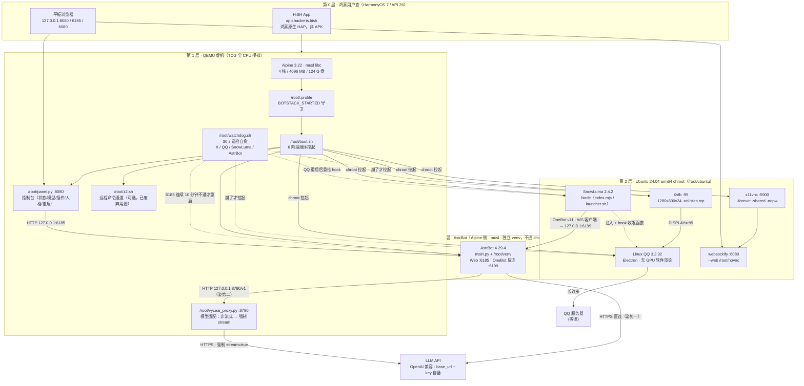
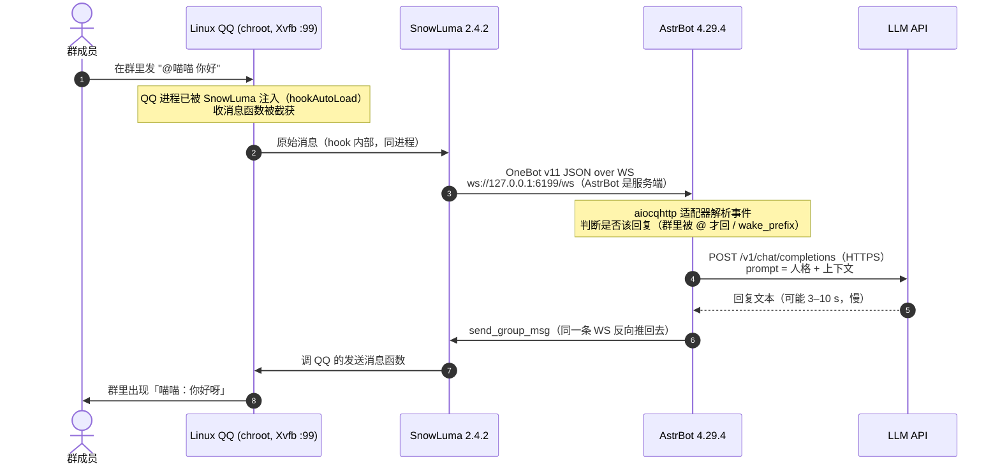
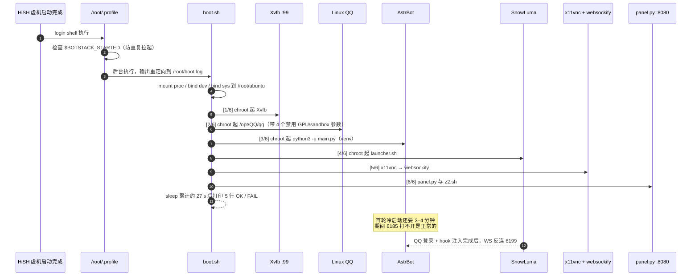
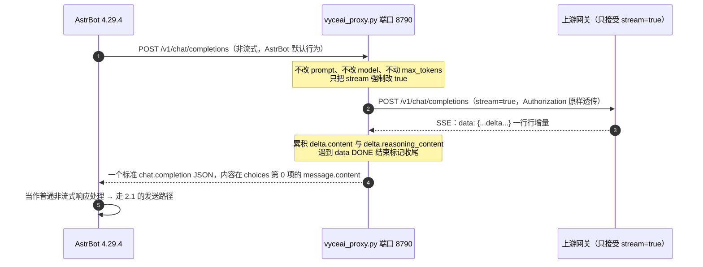

# 架构

本文回答三件事：这套东西由哪些部件组成、一条消息怎么走完全程、为什么在鸿蒙上必须这么做（而不是装个 APK）。

> 事实来源：本工程的实测部署（MatePad 11.5 S / HarmonyOS 7 / API 26 / HiSH）。凡未实测的推断都标了「待验证」。

---

## 1. 组件图

宿主机只有一层是「鸿蒙原生 App」，其它全在 Linux 里。这种「一层套一层」不是设计癖好，是能力分层的结果（见第 3 节）。



关键分层与端口：

| 层 | 主要进程 | 监听 |
|---|---|---|
| 鸿蒙 | HiSH（QEMU 宿主） | — |
| 虚机 / Alpine | `boot.sh`、`panel.py`、`z2.sh` | 8080 |
| 虚机 / Alpine（新增） | `watchdog.sh`（无监听，只巡检）、`vyceai_proxy.py` | **8790**（仅 127.0.0.1） |
| chroot / Ubuntu | `Xvfb`、`/opt/QQ/qq`、SnowLuma `index.mjs`、`x11vnc`、`websockify` | 5099、5900、6080 |
| AstrBot（Alpine 侧） | `main.py` | 6185（Web）、6199（OneBot 反向 WS） |

两个新增件的位置都是刻意的：

- **`watchdog.sh` 在 Alpine 侧、不在 chroot 里**：它要用 `chroot` 去判断 X 是否活着，站在外面才能同时管「chroot 里的 X/QQ/SnowLuma」和「Alpine 自己的 AstrBot」，进去就管不了了。
- **`vyceai_proxy.py` 也在 Alpine 侧**：它只是 AstrBot 的一个「假上游」，AstrBot 用 `127.0.0.1:8790` 访问它，它再出网；放 chroot 里反而多一层网络命名空间的麻烦。

为什么 AstrBot 不在 chroot 里而 QQ 在 chroot 里：**QQ 是给 glibc 编的**（二进制，只能待在 Ubuntu chroot 里）；**AstrBot 是纯 Python 应用**，用 Alpine 自带的 python3 + 独立 venv 就能跑，放在 chroot 外面省掉一层开销，也更贴近 `/root` 下的脚本与 `/root/venv` 的路径约定（`boot.sh` 里是直接 `python3 -u main.py`，没有 chroot）。两侧通过 `127.0.0.1` 直接互通——`chroot` 共享同一个内核网络栈，不需要额外转发。

---

## 2. 数据流

### 2.1 收消息 → 生成 → 回消息（一次完整往返）



几个容易误解的点：

- **方向是「反连」不是「直连」。** AstrBot 的 `aiocqhttp` 是**反向 WS 服务端**（`ws_reverse_host 0.0.0.0`、`ws_reverse_port 6199`），由 SnowLuma 作为客户端连上来。所以排查顺序永远是「先看 AstrBot 6199 在不在听，再看 SnowLuma 有没有连上」，反过来查会浪费一晚上。
- **OneBot 是协议，不是软件。** SnowLuma / NapCat 是它的实现，AstrBot 是消费者。三者任换其一不影响其它——这是这套架构唯一值得夸的地方。
- **回复策略在 AstrBot，不在 SnowLuma。** 「群里被 @ 才回」由 AstrBot 判断；SnowLuma 只管把全量消息推过去。所以「@ 它不回」也可能是 AstrBot 侧配置/模型问题，别只盯着 hook。

### 2.2 启动时序（开机 → 可用）



时间上的真实预期：`boot.sh` 打印完 `BOOT_DONE` 只代表**进程起来了**，不代表**链路通了**。QQ 自动登录约 20 秒、SnowLuma 注入约 10 秒、AstrBot 可用 3–4 分钟。想判断「真的好了」，要连到 6199 看 WS 有没有建立，而不是看 `pgrep` 有没有进程。

### 2.3 数据流：AstrBot → 代理 → 上游

这是**模型侧**的第三条流，和消息流是两回事：消息流（2.1）解决「消息怎么进来」，这条解决「prompt 怎么出去」。它只在「上游只接受流式」时才存在（见 [README](../README.md#模型对接的两种姿势)）。



三个容易搞错的点：

- **代理是「协议翻译」，不是「转发」。** 它必须读完整段 SSE 才能返回，所以**延迟等于整段生成时间**——`TIMEOUT` 默认 300 秒就是这个原因，别当成卡死。
- **它只监听 `127.0.0.1:8790`。** 位置在 AstrBot 同一侧（Alpine），因为 AstrBot 用 `http://127.0.0.1:8790/v1` 访问它；放 chroot 里要多一层网络折腾，收益为零。
- **上游若是整段不可用（`service_unavailable` / 全部 `invalid_request`），代理救不了。** 它只解决「非流式被拒」，不解决「上游挂了」；这时要么换直连网关，要么临时用 PC 的 8789 网关兜底（PC 必须开机）。

---

## 3. 为什么鸿蒙上必须用 QEMU 虚机

这一节是整个工程的判断核心。**能力在哪一层不存在，就不是配置问题，是换层问题。**

### 3.1 安卓那套为什么好用

```text
Android 内核允许 ptrace（能托管/跟踪别人的进程）
   └─▶ APK 能内置 PRoot / proot-distro，在手机里跑完整 Linux 用户态
        └─▶ astrbot-for-android、Termux 那类「一键 APK」因此存在
             └─▶ 装个 APK 就有 AstrBot + NapCat，十分钟搞定
```

PRoot 的原理是**用 ptrace 拦截每一条 syscall，把重定向到另一个人造根目录**。它不需要 root、不需要真虚机，代价是每条 syscall 多一跳——在 phone 上可以接受，因为它处在同一层内核里。

### 3.2 鸿蒙把这条路堵死了

```text
HarmonyOS NEXT 不是 Android：
  · 装 APK 只能经「卓易通」容器（syscall 白名单）
  · 卓易通封掉 ptrace
        └─▶ PRoot 无法再拦截 syscall
             └─▶ 实测报错：getcwd ENOSYS、SIGSYS（非法系统调用）
                  └─▶ 安卓一键版搬到鸿蒙必然失败——而且是结构性失败，不是改个参数能好
```

所以判断只有一条：**要 ptrace（要跑 PRoot、要跑需要完整内核语义的 Linux 用户态），就必须待在提供完整内核的那一层。** 鸿蒙用户态给不了，卓易通容器给不了，那就只能自己带一个内核——也就是 QEMU 跑真虚机。HiSH 就是干这个的。

### 3.3 虚机里为什么用 chroot 而不用 PRoot

虚机里 ptrace 是允许的（那是真实的 Linux 内核），所以 PRoot 理论上能跑。但**不应该**跑：

| 方案 | 开销 | 在 QEMU 上的实际后果 |
|---|---|---|
| `chroot` | 零（只是换根目录，syscall 直通） | 可用 |
| `proot` | 每条 syscall 拦一次并做路径翻译 | 在本来就慢 5–10 倍的 TCG 上再叠加一层，慢到不可用 |

这就是最终形态的由来：**Alpine（HiSH 自带、musl）× chroot 一个 Ubuntu 24.04 arm64（glibc）、Xvfb 假屏、Linux QQ**。musl 与 glibc 的分歧用「chroot 一个 glibc 发行版」解决，而不是去给 QQ 打 musl 补丁。

### 3.4 代价（必须承认的部分）

- QEMU 在鸿蒙上只有 **TCG（全 CPU 模拟）**，没有 KVM 加速。实测比真机慢 5–10 倍。
- 于是所有时间参数都要重新校准：AstrBot 冷启动 3–4 分钟、`pip install` 20–40 分钟、「点了没反应」有时只是还没跑完。
- 没 GPU，QQ 只能软件渲染；窗口一旦可见就持续重绘（实测 40%+ CPU），所以有 `hide_qq.sh` 把窗口 unmap。
- 内存/核数必须手动调大（默认 512 MB / 1 核根本装不动），且 HiSH 的 Alpine **默认关闭 OpenRC**，没有 `rc-update`，自启只能挂 login shell。

---

## 4. 组件清单（版本以实测为准）

| 组件 | 版本 | 位置 | 说明 |
|---|---|---|---|
| HiSH | 实测存在（版本号待补） | 鸿蒙 App | 提供 QEMU 虚机与终端；bundle `app.hackeris.hish` |
| Alpine | 3.22 | 虚机根 | musl；`/bin/sh` 为 busybox ash |
| Ubuntu base | 24.04.5 arm64 | `/root/ubuntu` | 只取 base 包，chroot 使用；apt 源为 `ubuntu-ports` |
| Xvfb | Ubuntu 包 | chroot 内 | `:99`，`1280x800x24`，`-nolisten tcp` |
| Linux QQ | 3.2.32 | `/opt/QQ/qq` | Electron；必须带 `--no-sandbox --disable-gpu --disable-dev-shm-usage --disable-software-rasterizer` |
| SnowLuma | 2.4.2 | `/root/sl` | Node，进程名 `index.mjs`；面板 5099 |
| AstrBot | 4.29.4 | `/root/src/AstrBot-master` + `/root/venv` | Web 6185；OneBot 反连 6199 |
| x11vnc / noVNC | Ubuntu 包 / `/root/novnc` | chroot 内 | 5900 RFB / 6080 WebSocket |
| 模型 | OpenAI 兼容 | — | 实测用过 `deepseek-v4.1`；base_url 与 key 自备，仓库不含任何密钥 |
| `watchdog.sh` | 本仓库脚本 | Alpine 侧 `/root/` | 30 s 巡检；状态写 `/root/watchdog.state`，事件写 `/root/watchdog.log` |
| `quick.sh` | 本仓库脚本 | Alpine 侧 `/root/` | 幂等修复 + 8 阶段体检；日志 `/root/quick.log` |
| `optimize.sh` | 本仓库脚本 | Alpine 侧 `/root/` | pyc 预编译 + QQ 参数收敛 + provider 收敛；幂等可重跑 |
| `vyceai_proxy.py` | 本仓库脚本 | Alpine 侧 `/root/` | 流式适配代理，`127.0.0.1:8790`，日志 `/root/vyceai_proxy.log` |
| `panel_v3.py` | 本仓库脚本 | Alpine 侧 `/root/panel.py` | 控制台/设置页/维修页，8080；日志 `/root/panel.log` |
| `pc_bootstrap.py` | 本仓库脚本 | **PC 侧** `tools/` | 编排 + 取证，不参与运行；`tools/remote.log` |

> 版本号会漂移：升级 SnowLuma/AstrBot 后如果行为不一致，先怀疑版本差异，再怀疑配置。
