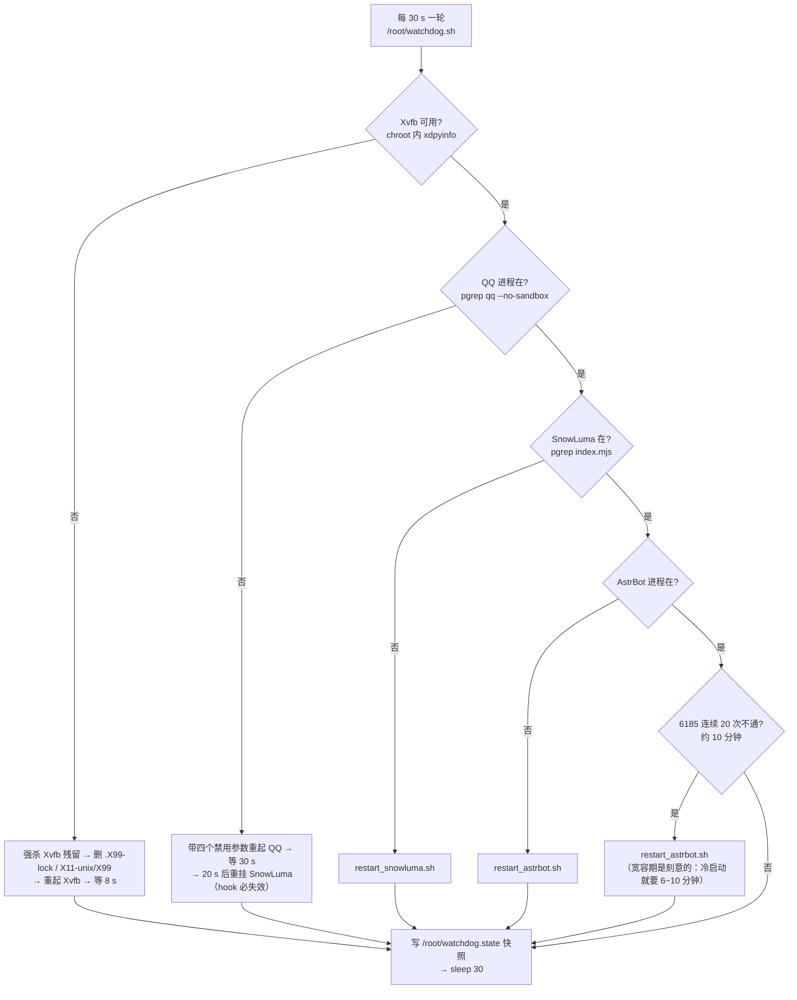

# 部署流程

七步从一台还没装任何东西的鸿蒙平板，走到「开机自动回复」。下面的步骤编号与原始教学文档
（工程外部的 Markdown 笔记，未随本仓库发布）的阶段 0–7 对应关系如下：

| 本文步骤 | 教学文档阶段 | 内容 | 能否脚本化 |
|---|---|---|---|
| 步骤 0 | — | 前置条件检查（平板、网络、PC 工具） | 部分 |
| 步骤 1 | 阶段 0 | 用 hdc 接管平板（开开发者选项、截屏、点击、打字） | ✅ `tools/hm.py` |
| 步骤 2 | 阶段 1 | 把 HiSH 虚机调到 4 核 / 4096 MB + 端口映射 | ❌ 手动点 |
| 步骤 3 | 阶段 2 | Alpine 里 chroot 一个 Ubuntu 24.04 arm64 | ✅ `scripts/install.sh 2` |
| 步骤 4 | 阶段 3 | 图形环境（Xvfb）+ 装 Linux QQ + 扫码登录 | 部分 |
| 步骤 5 | 阶段 4 | SnowLuma 注入 QQ，配 OneBot | ❌ 手动（要授权+选进程） |
| 步骤 6 | 阶段 5 | AstrBot + 模型源 + 6199 反连 | ✅ `scripts/install.sh 5` |
| 步骤 7 | 阶段 7 | 开机自启（login shell 钩子） | ✅ `scripts/install.sh 7` |
| 附录 A | 阶段 6 | 远程命令通道 `z2.sh`（可选，日常用不到） | 可选 |

> 教学文档里写的「7 个阶段」指阶段 0–7 这 8 个里去掉可选的后门阶段；本文按「七步可交付」重排，映射见上表。

---

## 步骤 0 · 前置条件

| 项 | 要求 | 怎么确认 |
|---|---|---|
| 设备 | 能装 HiSH 的鸿蒙设备（本文实测：华为 MatePad 11.5 S，HarmonyOS 7，API 26） | 设置 → 关于本机 |
| 存储 | 虚机盘 ≥ 20 GB（QQ + Ubuntu + AstrBot 依赖很占地方；实测给到 124 G） | HiSH 模拟器管理页 |
| 网络 | 平板能上公网（apt/pip/模型 API 都要），且与 PC 同网段（可选，用 hdc 时需要） | 虚机里 `wget -qO- https://mirrors.aliyun.com` |
| 一个 QQ 号 | 建议小号；要能在平板上用手机 QQ 扫码登录 | — |
| 模型 | 一个 OpenAI 兼容的 `base_url` + `key`（能 HTTPS 访问） | 虚机里 `curl -I <base_url>` |
| PC（可选） | `hdc`（鸿蒙版 adb）+ 本仓库 `tools/hm.py` | `python tools/hm.py devs` |

先把「慢」这个心理预期建立好：**QEMU 只有 TCG，比真机慢 5–10 倍**。后面每一步的等待时间都是这个前提下的实测值。

---

## 步骤 1 · 用 hdc 接管平板

平板端：设置 → 关于本机 → 连点「软件版本」5 次 → 开开发者模式 → 设置 → 系统 → 开发者选项 → 打开 **USB 调试**（或无线调试，记下 `IP:端口`）。

PC 端：

```bash
python tools/hm.py devs            # 广播发现 + 列出目标
python tools/hm.py conn 192.168.x.x:37111   # 无线调试（端口每次开关都变）
python tools/hm.py info            # 型号 / 系统版本 / API / 分辨率
python tools/hm.py shot out.png    # 截屏回 PC
```

踩过的坑（三条，都值得记住）：

1. 点击命令是 `uitest uiInput click <x> <y>`，**不是 `tap`**。用 `tap` 返回 `Invalid parameters.`，而当时把 stderr 重定向到了 `/dev/null`，于是「点了没反应」排查了很久。**永远不要扔掉 stderr。**
2. Git Bash 会把 `/data/local/tmp` 转成 Windows 路径，必须加 `MSYS_NO_PATHCONV=1 MSYS2_ARG_CONV_EXCL='*'`。
3. USB 口上会出现 COM3/COM4 串口干扰 hdc 的设备选择，每条命令都要 `-t <序列号>`（`hm.py` 已内置自动挑选 USB/TCP 目标的逻辑）。

---

## 步骤 2 · 把虚机调到能用

HiSH 默认虚机是 **512 MB / 1 核**，连 `apt update` 都跑不完。

1. 进 HiSH 终端 → 右下角 **齿轮** → 模拟器管理 → 修改 → **4 核 / 4096 MB** → 保存并重启虚机。
2. 加端口映射：**客户机 6185 ↔ 主机 6185**（这样平板浏览器才能打开 AstrBot 后台）。控制台 8080、桌面 6080 同理按需加。

```sh
# 虚机里确认（应看到 4 核、约 3900 MB 可用）
nproc; free -m | sed -n 2p
```

---

## 步骤 3 · 在 Alpine 里 chroot 一个 Ubuntu

HiSH 自带 Alpine（musl），而 Linux QQ 是给 glibc 编的。方案：**chroot 一个 Ubuntu 24.04 arm64**，不用 PRoot（虚机里 ptrace 允许，但 PRoot 会拦每条 syscall，在 TCG 上慢到不可用）。

```sh
apk add --no-cache tar wget              # busybox tar 解 ubuntu-base 会失败（merged-/usr 软链），必须装 GNU tar
wget -O /root/ubuntu-base.tar.gz \
  http://cdimage.ubuntu.com/ubuntu-base/releases/24.04/release/ubuntu-base-24.04.5-base-arm64.tar.gz
mkdir -p /root/ubuntu
tar -xzf /root/ubuntu-base.tar.gz -C /root/ubuntu   # 解两遍；第一遍报 dev/ 相关错误是正常的
tar -xzf /root/ubuntu-base.tar.gz -C /root/ubuntu

mount -t proc proc /root/ubuntu/proc
mount --bind /dev  /root/ubuntu/dev
mount --bind /sys  /root/ubuntu/sys
chroot /root/ubuntu /bin/bash
```

chroot 内换 apt 源：arm64 **必须用 `ubuntu-ports`**，不是 `archive`。

```sh
cat > /etc/apt/sources.list <<'EOF'
deb http://mirrors.aliyun.com/ubuntu-ports/ noble main restricted universe multiverse
deb http://mirrors.aliyun.com/ubuntu-ports/ noble-updates main restricted universe multiverse
deb http://mirrors.aliyun.com/ubuntu-ports/ noble-backports main restricted universe multiverse
deb http://mirrors.aliyun.com/ubuntu-ports/ noble-security main restricted universe multiverse
EOF
apt-get update -y
```

或者直接：`sh scripts/install.sh 2`。

---

## 步骤 4 · 图形环境 + Linux QQ + 扫码

QQ 是 Electron，**必须有显示器**。平板没有可用的物理屏，所以用 Xvfb 造假屏：

```sh
apt-get install -y xvfb x11-utils fonts-noto-cjk libnss3 libatk1.0-0t64 libgbm1 \
  libxkbcommon0 libgtk-3-0 libasound2t64 libsecret-1-0 imagemagick xdotool
Xvfb :99 -screen 0 1280x800x24 -nolisten tcp &
DISPLAY=:99 /opt/QQ/qq --no-sandbox --disable-gpu --disable-dev-shm-usage --disable-software-rasterizer
```

四个启动参数不是可选项：`--disable-dev-shm-usage` 是因为虚机 `/dev/shm` 太小（QQ 会直接崩），`--disable-gpu` 是因为 TCG 下没有可用 GPU。

怎么看见屏幕：

```sh
DISPLAY=:99 import -window root /root/shot.png     # 截图（ImageMagick）
```

没有画面通路时，走 noVNC（步骤 7 起的 6080）最省事：浏览器打开 `http://127.0.0.1:6080/vnc.html` 就能看到 QQ 二维码并扫。二维码会过期，**虚机时间不同步时会很快过期**，点刷新重新出码后尽快扫。

怎么点屏幕：

```sh
DISPLAY=:99 xdotool mousemove 640 400 click 1
```

---

## 步骤 5 · SnowLuma：把 QQ 变成可编程

QQ 不开放接口，SnowLuma 这类工具**往 QQ 进程注入代码（hook）**，截获收发消息函数，对外暴露 **OneBot v11**。

```text
QQ 进程 ──注入──▶ SnowLuma ──OneBot(JSON over WebSocket)──▶ AstrBot
```

1. 把 SnowLuma（实测 2.4.2）解到 `/root/sl`，确认里面有 `launcher.sh`，启动后进程名是 `index.mjs`。
2. 浏览器开 `http://127.0.0.1:5099`：**同意协议 → 设密码 → 选中 QQ 进程 → 点「加载」注入**。
   （平板本地打不开 5099 是因为没加端口映射；用 PC 的 `python tools/hm.py fport 5099` 转发，或在 noVNC 里开。）
3. OneBot 侧填 WS **客户端**地址 `127.0.0.1:6199`（连 AstrBot），或按面板实际字段填；协议选 OneBot v11。
4. 勾上 `hookAutoLoad: true`，QQ 一启动就自动注入——这是开机自启链条的一半。

---

## 步骤 6 · AstrBot：说话的大脑

AstrBot 是纯 Python，**装在 Alpine 侧**（不 chroot），用独立 venv 隔离：

```sh
apk add --no-cache python3 py3-pip git build-base libffi-dev openssl-dev
git clone https://github.com/AstrBotDevs/AstrBot /root/src/AstrBot-master
python3 -m venv /root/venv
/root/venv/bin/pip install -U pip
/root/venv/bin/pip install -r /root/src/AstrBot-master/requirements.txt
cd /root/src/AstrBot-master && /root/venv/bin/python3 -u main.py
```

（`build-base / libffi-dev / openssl-dev` 是 musl 上编译少数 C 扩展用的；缺哪个补哪个，具体依赖随 AstrBot 版本变化，待验证。）

首启动会生成 `data/cmd_config.json`，然后：

```sh
python3 scripts/patch_cfg.py     # platform 改成 aiocqhttp，ws_reverse_port 6199
python3 scripts/only_deepseek.py # 模型列表收敛到单个可用模型（可选）
```

要点：

- `platform.type` = `aiocqhttp`，`ws_reverse_host` = `0.0.0.0`，`ws_reverse_port` = `6199`。AstrBot 是**服务端**，等 SnowLuma 连进来。
- **该 JSON 带 UTF-8 BOM**，读写必须 `encoding='utf-8-sig'`，否则 `json.load` 直接抛异常——这是「AstrBot 起来就退」最常见的原因。
- 模型源填 OpenAI 兼容：`base_url` + `key` + `model`（实测用过 `deepseek-v4.1`）。**key 不要提交进仓库。**
- 必须以 `python3 -u main.py` 启动（关 stdout 缓冲），否则重定向到 `/root/ab.log` 时看不到日志。
- 冷启动 3–4 分钟，期间 6185 打不开是正常的。

---

## 步骤 7 · 开机自启

HiSH 的 Alpine 明确写了 **OpenRC is disabled by default**，所以别想 `rc-update`，改挂 login shell：

```sh
# /root/.profile 末尾（scripts/install.sh 7 会自动加）
if [ -z "$BOTSTACK_STARTED" ]; then
  export BOTSTACK_STARTED=1
  ( sh /root/boot.sh > /root/boot.log 2>&1 & )
  echo "[bot] 正在启动 QQ / SnowLuma / AstrBot ..."
fi
```

`/root/boot.sh` 是幂等的 6 阶段启动器：挂 `proc/dev/sys` → Xvfb → QQ → AstrBot → SnowLuma → x11vnc+noVNC → 控制台 + 远程通道 → 打印状态。已跑的进程不会被重复拉起，所以救火时手动再跑一次也安全。

验证：重启虚机，等 5 分钟，`tail -20 /root/boot.log` 应看到 5 行 `OK` 与 `BOOT_DONE`。

---

## 启动时序（自启 → 链路真正可用）

```mermaid
sequenceDiagram
  autonumber
  participant P as /root/.profile
  participant B as boot.sh
  participant X as Xvfb :99
  participant Q as Linux QQ
  participant A as AstrBot
  participant S as SnowLuma
  participant N as noVNC 6080

  P->>P: 判断 $BOTSTACK_STARTED，避免重复拉起
  P->>B: 后台执行，日志 → /root/boot.log
  B->>B: mount proc / bind dev / bind sys
  B->>X: [1/6] 起假屏（等待约 4 s）
  B->>Q: [2/6] 起 QQ（等 10 s）
  Q->>Q: 自动登录（约 20 s，已扫码过则免扫）
  B->>A: [3/6] 起 AstrBot（不等待，冷启动 3–4 分钟）
  B->>S: [4/6] 起 SnowLuma（等 6 s）
  S->>Q: 注入 + hook（约 10 s）
  S->>A: WS 反连 127.0.0.1:6199 —— 链路这一处通了才算通
  B->>N: [5/6] x11vnc + websockify
  B->>B: [6/6] panel.py + z2.sh
  B-->>B: 打印 5 行 OK / FAIL + BOOT_DONE（累计约 27 s）
  Note over A: 此时 6185 多半还打不开<br/>这是正常的，不是挂了
  A-->>A: 冷启动完成，6185 返回 200
  Note over Q,S,A: 真正可用的判据：6199 有 ESTABLISHED 且 6185 可打开
```

各阶段的实测量级（TCG，别按真机预期）：

| 阶段 | 耗时 | 说明 |
|---|---|---|
| `boot.sh` 跑到 `BOOT_DONE` | 约 27 秒 | 只是进程拉起，不代表链路通 |
| QQ 自动登录 | 约 20 秒 | 已扫码过免扫 |
| SnowLuma 注入 → WS 反连成功 | 约 10 秒 | 依赖 QQ 已登录 |
| AstrBot 冷启动 → 6185 可打开 | 3–4 分钟 | 最容易被误判为「挂了」 |
| `pip install`（首次装依赖） | 20–40 分钟 | 编译型依赖在 TCG 上极慢 |

**这段最重要的结论**：`BOOT_DONE` 只表示进程起来了，不表示链路通了。真正的可用判据是「6199 上有 WS 连接」+「6185 能打开」。


```sh
# 链路是否真的通（不是看进程，是看连接）
netstat -ltn 2>/dev/null | grep -E '6185|6199|5099|8080'
chroot /root/ubuntu /bin/bash -c 'ss -tn 2>/dev/null | grep 6199 || netstat -tn | grep 6199'
tail -50 /root/ab.log
```

---

## 故障自愈流程（watchdog）

`/root/watchdog.sh` 是个常驻的 `while true` 循环，**每 30 秒**（`INTERVAL` 环境变量可改）把四个服务过一遍。它只做一件事：**发现不在就拉起来**，不做诊断、不发通知。所以「自愈」=「恢复到能跑」，不等于「问题解决了」。



| 触发条件 | 动作 | 日志位置 |
|---|---|---|
| chroot 内 `DISPLAY=:99 xdpyinfo` 失败 | 强杀残留 Xvfb、删 X 锁、重起、等 8 s | `/root/watchdog.log`、`/root/xvfb.log` |
| `pgrep -f "qq --no-sandbox"` 空 | 重起 QQ、等 30 s、再重挂 SnowLuma | `/root/watchdog.log`、`/root/qq.log` |
| `pgrep -f "index.mjs"` 空且 QQ 在 | `restart_snowluma.sh` | `/root/watchdog.log`、`/root/sl.log` |
| `pgrep -f "main.py"` 空 | `restart_astrbot.sh` | `/root/watchdog.log`、`/root/ab.log` |
| AstrBot 进程在但 6185 连续 20 次不通 | `restart_astrbot.sh`（清计数） | `/root/watchdog.log`、`/root/ab.log` |
| 每轮结束 | 写 `x= qq= sl= ab=` 四个字段 | `/root/watchdog.state` |

**watchdog 管不到的四件事（必须人工）**：

1. **QQ 掉登录。** 它只判「进程在」，二维码页也算进程在，所以不会拉起循环，也不会帮你扫码——开 `http://127.0.0.1:6080/vnc.html` 扫。
2. **6199 没连上。** 它不看 WS 连接，只看进程/端口。链路断在 SnowLuma → AstrBot 这一段时它认为一切正常。
3. **模型上游挂了。** 6185 能打开 = AstrBot「健康」，但 API 4xx/超时它完全不知道。
4. **它自己死了。** `pgrep -f watchdog.sh` 空就重跑 `sh /root/quick.sh`（quick.sh 会补拉起看门狗）。

**什么时候别再靠它自愈**：5 分钟内 QQ 崩 3 次以上，说明不是偶发而是配置/资源问题——按 [README「性能与稳定性」](../README.md#性能与稳定性) 把核数从 8 降到 4（或 6）。硬撑 8 核只会陷入「崩 → 拉起 → 再崩」的循环，每次恢复还要几分钟。

---

## 平板重启后的 15 分钟恢复清单

> 提炼自当日复盘计划（工程外部的《计划-平板机器人.md》，未随本仓库发布）。
> 前提：平板插 USB（或同一 WiFi + hdc 无线）并且**不要锁屏**——锁屏会冻结 HiSH 里的 VM。
> 电脑侧一条命令启动：`py -3.12 tools/pc_bootstrap.py`（`--check` 只看状态，不动手）。

| 步骤 | 动作 | 预计 | 失败兜底 |
|---|---|---|---|
| 1 | 检查 PC 三个服务（80 / 8081 / 8789），缺的自动拉起 | 10 s | 手动 `py -3.12 fwd8789.py` |
| 2 | hdc 连平板：`hdc -t <序列号> shell echo ok` | 10 s | 确认 USB 调试已允许（平板弹窗点「允许」） |
| 3 | 下发 `quick.sh`：挂载 → 清 X 锁 → Xvfb → QQ → SnowLuma → AstrBot → 控制台 → 看门狗 → 链路体检 | 3~6 min | z2 通道死了就用 hdc 在终端敲 `sh /root/quick.sh` |
| 4 | 跑 `optimize.sh`：预编译 pyc、QQ 参数收敛、关掉不用项 | 2 min | 幂等，可重跑 |
| 5 | 截图取证：平板屏 + VM 桌面 + 控制台 + 设置页 → 存 `docs/screenshots/` | 30 s | 截不到先看 VM 是不是被挂起 |
| 6 | 端到端测试：OneBot 发一条私聊 → 在群里 @ 一次 → 看 `/root/ab.log` 确认 | 2 min | `tests/e2e_test.sh` |
| 7 | 写测试记录进 [docs/testing.md](testing.md)、更新 CHANGELOG、`git init` + 首次提交 | 5 min | — |

**同时要人做（3 件，都很小）**：

1. **把 CPU 从 8 调回 4（或 6）** —— 8 核下 TCG 的 SMP 不稳，QQ 反复原生崩溃；4 核是「连跑几小时不崩」的配置。HiSH → 右下齿轮 → 模拟器管理 → 修改 → CPU 选 4 → 完成 → 运行。
2. **给一个能直连的模型 key**（DeepSeek 官方或其他站）。当前 `vyceai` 全线不可用，平板只能借 PC 的网关（`ben/deepseek-v4.1-flash`）；有了直连 key 才真正不依赖电脑。
3. **确认许可证**：仓库按 MIT 写（只含胶水脚本与文档），AstrBot 本体仍 AGPL-3.0 并在 README 声明。

---

## 故障排查表

按「症状 → 最可能原因 → 查什么」推进，不要凭感觉改配置。

| 症状 | 最可能原因 | 命令 / 动作 |
|---|---|---|
| 6185 打不开 | AstrBot 还没起完（3–4 分钟），或 HiSH 端口映射丢了 | `netstat -ltn \| grep 6185`；`tail -50 /root/ab.log`；回 HiSH 齿轮页看映射还在不在 |
| AstrBot 起来就退 | 端口 6185 被占 / `cmd_config.json` 坏（BOM 或缺字段） | `tail -50 /root/ab.log`；`python3 -c "import json;json.load(open('/root/src/AstrBot-master/data/cmd_config.json',encoding='utf-8-sig'))"` |
| 群里 @ 它不回 | 四种可能依次排：QQ 未登录 / SnowLuma 未注入 / AstrBot 没连上 / 模型没配好 | `pgrep -f '/opt/QQ/qq'` → SnowLuma 面板「进程注入」页 → `netstat -tn \| grep 6199` → `/root/ab.log` 里的 4xx/超时 |
| QQ 一启动就崩 | 少带禁用 GPU / dev-shm 的参数，或 `/dev/shm` 太小 | `cat /tmp/qq.out`；确认四个参数 `--no-sandbox --disable-gpu --disable-dev-shm-usage --disable-software-rasterizer` |
| QQ 登录失效 | 扫码会话过期 / 被踢 | 开 `http://127.0.0.1:6080/vnc.html` 出二维码，手机 QQ 扫码 |
| 二维码总过期 | 虚机时间不同步 | 点刷新重出码尽快扫；`date` 看虚机时间偏差 |
| SnowLuma 面板 `Failed to fetch` | 隧道/端口转发里有死连接 | 重连转发（`python tools/hm.py fport 5099`），或在平板本地直接开 `127.0.0.1:5099` |
| SnowLuma 注入失败 / hook 无效 | QQ 没起全就注入了，或 QQ 版本不匹配 | 先 `pgrep -f index.mjs` 确认没残留，`sh /root/restart_qq.sh` 后再注入 |
| `No space left on device` | `/tmp` 是 128 MB tmpfs | `df -h`；`export TMPDIR=/root/tmp`；`du -sh /root/* \| sort -h` |
| 重启虚机后什么都没起 | `/root/.profile` 钩子没写、被覆盖，或虚机是 no-login 启动 | `grep -n BOTSTACK /root/.profile`；手动 `sh /root/boot.sh` |
| 进程都在但 QQ 界面黑屏/不刷新 | 窗口被 unmap 过（`hide_qq.sh`）或 Xvfb 挂了 | noVNC 里看桌面；`pgrep -f 'Xvfb :99'` |
| CPU 长期 100% | QQ 窗口可见（软件渲染持续重绘） | 跑 `sh /root/hide_qq.sh` 把窗口 unmap |
| `pkill -f xxx` 把脚本自己也杀了（rc=143） | `sh -c '...'` 的命令行里含匹配串，匹配到自身 | 写进独立 `.sh` 文件执行，或加字符类（`main[.]py`） |
| 中文日志乱码 | 终端编码 / busybox 工具差异 | `export LANG=C.UTF-8`；必要时用 `chroot ... /bin/bash -lc` |

---

## 日常操作卡

```sh
# 看四个服务（应输出 4 个 PID）
pgrep -f 'Xvfb :99'; pgrep -f '/opt/QQ/qq'; pgrep -f index.mjs; pgrep -f 'main[.]py'

# 手动全量启动（开机已自动，救火用）
sh /root/boot.sh

tail -50 /root/boot.log        # 启动日志
tail -f  /root/ab.log          # 机器人日志（AstrBot）

# 只重启机器人（3 分钟起来）
sh /root/restart_astrbot.sh

# 两件套按序重启（改完配置用这个）
sh /root/restart_all.sh

# 平板浏览器入口
#   http://127.0.0.1:8080   控制台
#   http://127.0.0.1:6185   AstrBot 后台
#   http://127.0.0.1:6080/vnc.html   noVNC 桌面（扫码用）
```

## 附录 A · 远程命令通道（可选，日常不需要）

没有稳定 SSH 时的旁路：

```text
PC: py -3.12 -m http.server 80      # 提供 cmd.txt
PC: logsvr.py 监听 8081             # 收虚机 POST 回来的输出
VM: /root/z2.sh 每 4 秒 wget cmd.txt → 内容变化就执行 → 结果 POST 回 8081
```

**这是「谁写 cmd.txt 谁就能拿到 shell」的通道**，仅限内网自用。用完请从 `boot.sh` 的 `[6/6]` 里删掉那两行，或者删掉 `/root/z2.sh`。
